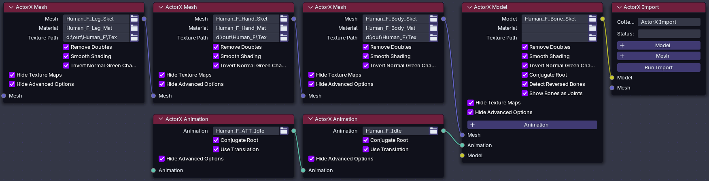

# Prototype Batch ActorX (psk, psa) Importer for Blender

Import multiple models, meshes, textures and animations at a time. Visually build your import using custom nodes.

- [Why Nodes?](#why-nodes)
- [Important Information](#important-information)
- [Requirements](#requirements)
- [Getting Started](#getting-started)

## Why Nodes?

Blender addons do not have access to a standard tree control. Indented lists can simulate a tree but nodes are actual tree controls. This lets you visually build an import by connecting models, meshes and animations together. Nodes do have some quirks. See the recommendations for using node trees for more information.

## Important Information

Although ActorX is a standard not all models are exported with the same coordinate system. This addon was tested on a single UE3 game from UEViewer (umodel) exports. My imports work as expected but your success may vary. If you have problems consult the troubleshooting section first.

Models exported from RealEditor look correct, however, I've found it difficult to connect things like faces to bodies. The bones in exports from DarklightGames Blender addon do not face the right direction. Currently I have no plans to figure it out.

## Requirements

- Blender 4.2.9 or later. Blender 5.2.2 is the current release at the time of this documentation.
- ActorX assets exported from UEViewer (umodel).
- How to install addons and how to use different editor types in Blender.
-  An understanding of how UEViewer assets are exported, particularly what folders they are placed in.

## Getting Started

TDB.